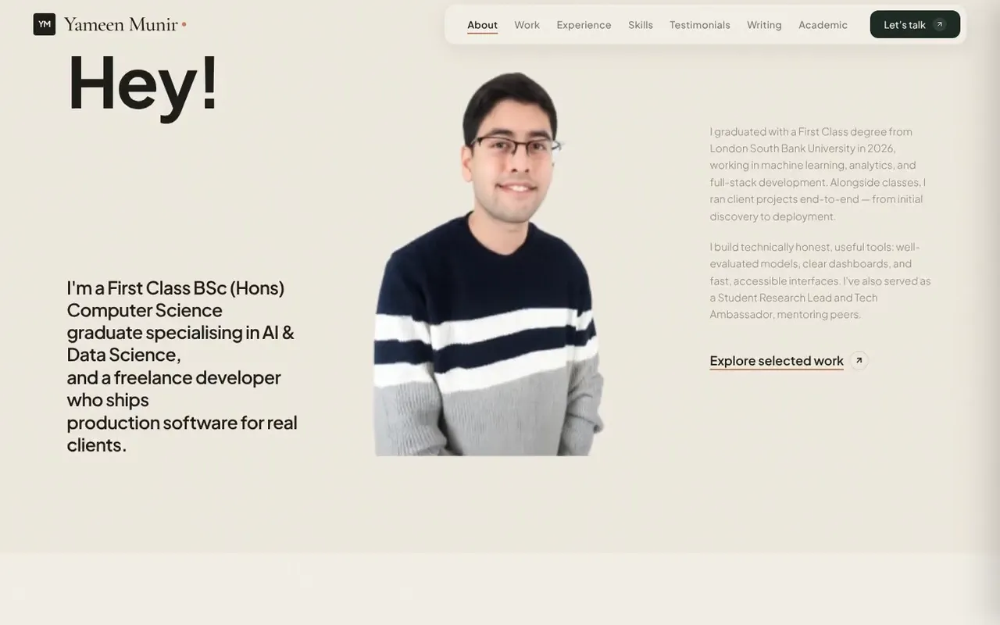

# Yameen Munir, portfolio

An editorial portfolio for Yameen Munir, an AI and data science developer in London. I designed and built it.

**Live:** [yameenmunir-two.vercel.app](https://yameenmunir-two.vercel.app)



## What's on it

- **An entrance screen** that opens onto the hero, where a silhouette turns into his portrait
- **Split-text and flip reveals** on headings as they scroll in
- **A portrait flip card**, **magnetic buttons** and a **custom cursor**
- **Smooth scrolling** with Lenis, and a reduced-motion version for people who prefer less movement
- **Sections:** about, experience, academic work, selected projects, skills, writing, press, testimonials and contact
- **A contact form** with server-side validation

## Built with

Next.js 16 (App Router), React 19, TypeScript, GSAP, Lenis, Lucide icons.

## Structure

```
app/
  page.tsx               the page, section by section
  api/contact/route.ts   contact form endpoint
components/
  sections/              Hero, About, Experience, Academic, SelectedWork, Skills, Writing, Press, Testimonials, Contact
  ui/                    Cursor, SplitText, FlipTextReveal, MagneticButton, PortraitFlipCard
  layout/
data/                    content for experience, academic work and press
hooks/useReducedMotion.ts
```

## Run it

```bash
npm install
npm run dev     # http://localhost:3000
```

---

Designed and built by [Muhammad Rayyan](https://rayyan-portfolio-xi.vercel.app).
